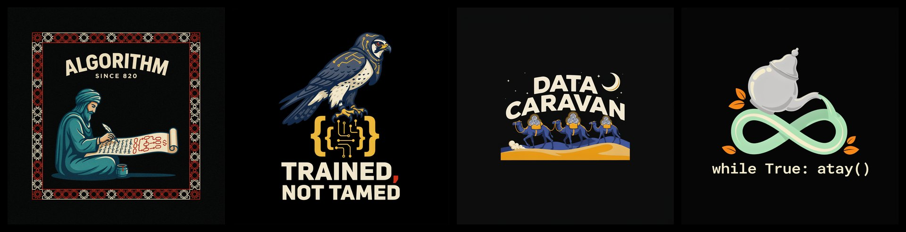
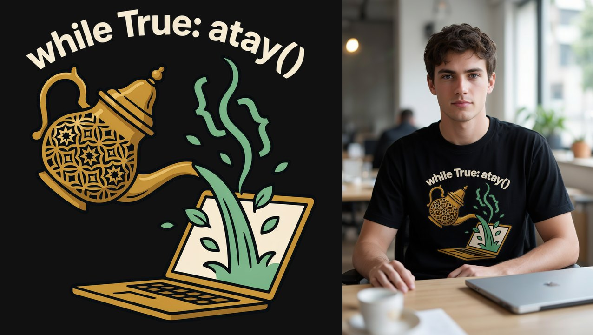
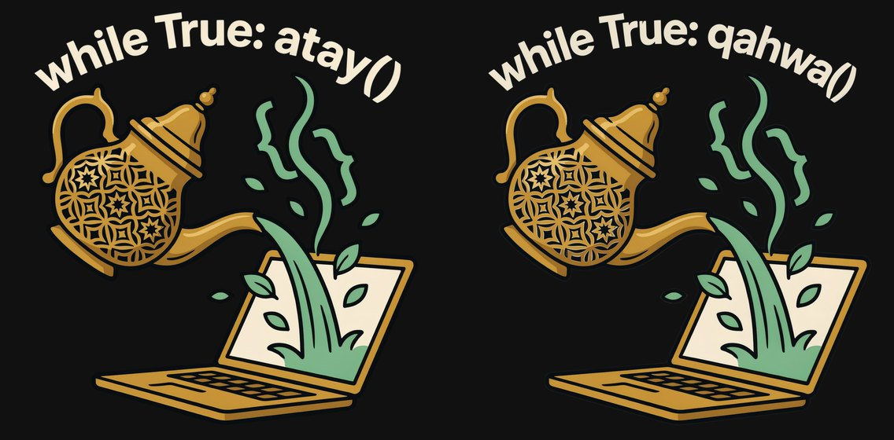
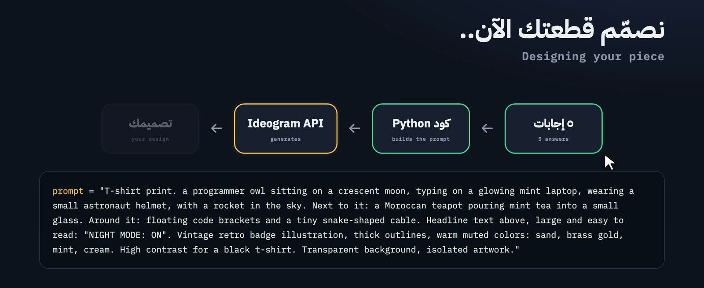
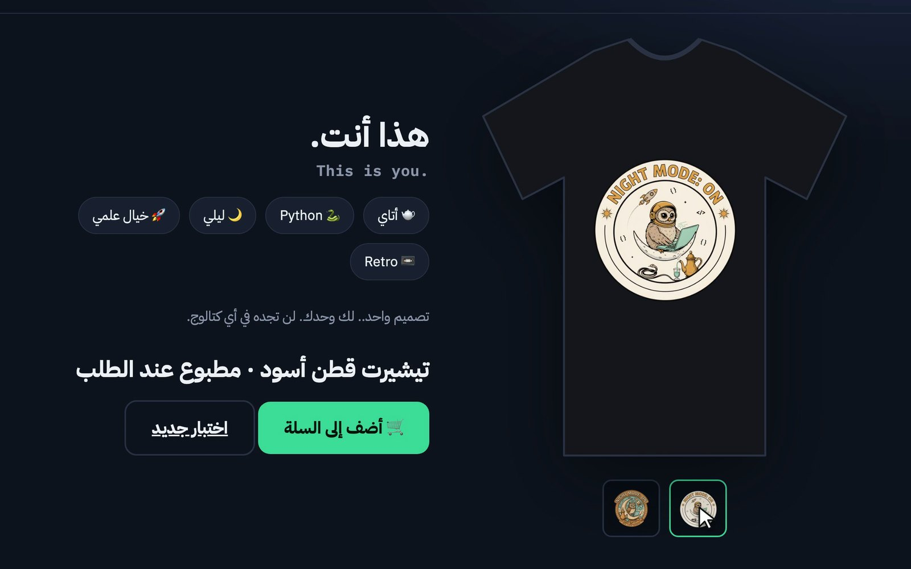
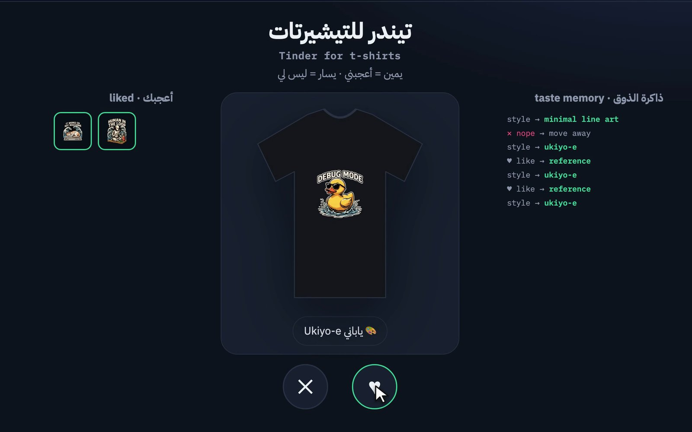
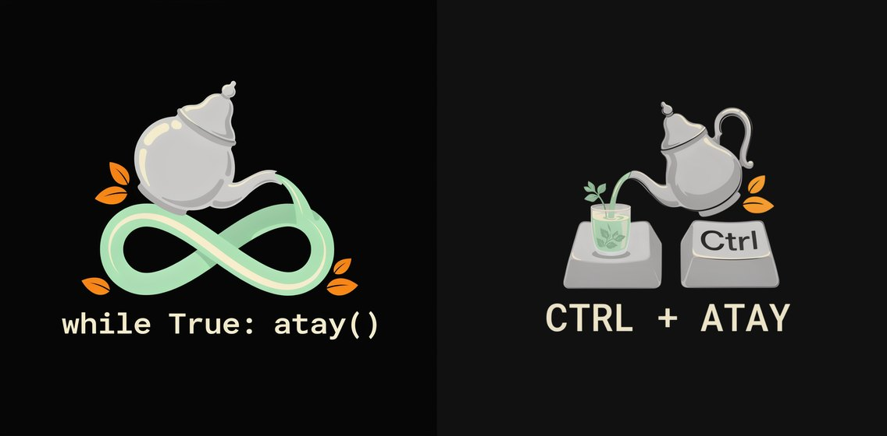
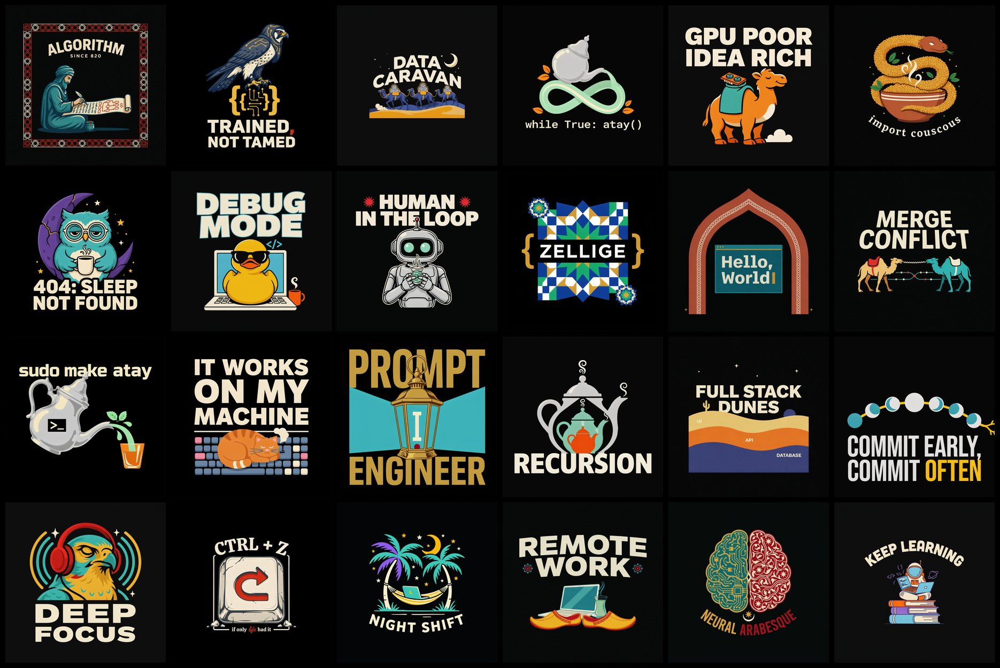

<div dir="rtl" align="right">

# 👕 من فكرة إلى تيشيرت بالذكاء الاصطناعي: Ideogram POD Studio + بايثون

<p align="center">
  <a href="https://www.youtube.com/@PythonArab">
    
  </a>
  
  
  
</p>

<p align="center">
  👉 <a href="https://www.youtube.com/@PythonArab"><b>اضغط هنا لمشاهدة الحلقة كاملة على يوتيوب</b></a> 👈
</p>

<p align="center">
  
</p>

مرحباً بك في المستودع المرجعي لحلقة **Ideogram POD Studio** على قناة Pythonation: كيف تحوّل فكرة واحدة إلى تيشيرت جاهز للطباعة بالذكاء الاصطناعي، ثم كيف تحوّل متجرك كله إلى نظام يصمّم لكل زبون منتجه الخاص.

يجمع هذا المستودع كل ما وعدنا به في الفيديو:

* **السكريبتات الثلاثة بالبايثون:** مصنع التصاميم، والمتجر الذي يصمّم لكل زبون (اختبار الشخصية + تيندر التيشيرتات)، وحلقة الأسبوع التي تتعلم من سلوك المشترين. جرّبناها كلها على Ideogram API الحقيقي.
* **البرومبتات الجاهزة للنسخ**، ومنها 24 برومبت لتشكيلة كاملة.
* **طريقة ربط Ideogram بوكلاء الذكاء الاصطناعي** (Claude Code / Codex) عبر بروتوكول MCP.
* **شروط استخدام الـAPI** التي يجب أن تعرفها قبل أن تطلق مشروعك للناس.
* **المصادر والروابط** لكل رقم ذكرناه.

🎨 **[جرّب Ideogram POD Studio من هنا](https://ideogram.ai/studios/print-on-demand?productId=ideogram.ai&ucc=z6DduRv16o5)** (رابط إحالة)

> 🌟 الحلقة برعاية Ideogram. الكود مفتوح المصدر ومستقل، ويعمل بأي حساب Ideogram API.

---

## 📑 فهرس المحتويات

1. [🧾 فاتورة 2020 ضد فاتورة اليوم](#-1-فاتورة-2020-ضد-فاتورة-اليوم)
2. [🎨 الطريق داخل POD Studio خطوة بخطوة](#-2-الطريق-داخل-pod-studio-خطوة-بخطوة)
3. [🤖 الأتمتة الأولى: وكلاء الذكاء الاصطناعي عبر MCP](#-3-الأتمتة-الأولى-وكلاء-الذكاء-الاصطناعي-عبر-mcp)
4. [🐍 الأتمتة الثانية: المتجر الحي عبر الـAPI](#-4-الأتمتة-الثانية-المتجر-الحي-عبر-الـapi)
5. [📜 قبل الإطلاق: شروط استخدام الـAPI](#-5-قبل-الإطلاق-شروط-استخدام-الـapi)
6. [👕 تشكيلة مجتمعنا البرمجي](#-6-تشكيلة-مجتمعنا-البرمجي)
7. [📚 المصادر والروابط](#-7-المصادر-والروابط)
8. [🤝 المساهمة ودعم المحتوى](#-8-المساهمة-ودعم-المحتوى)
9. [🇬🇧 English quick start](#english-quick-start)

---

## 🧾 1. فاتورة 2020 ضد فاتورة اليوم

في 2020 اشتريت آلة طباعة حرارية بتقنية DTF لأبني مشروعي التجاري الأول، وبعت بين 500 و1000 تيشيرت وهودي بتصاميم أصلية. ثم أغلقت المشروع بعد خسارة كبيرة. هذه هي الفاتورة المخفية التي لا يتحدث عنها أحد، مقابل نفس الطريق اليوم:

| المرحلة | في 2020 (من تجربتي) | اليوم داخل POD Studio |
|---|---|---|
| آلة الطباعة | 15,000 دولار للآلة وحدها | لا تحتاجها: الطباعة عند الطلب عبر مطبعة شريكة |
| الرسم والتصميم | 15 إلى 30 دولاراً لتصميم بسيط مقلّد، و50 إلى 100 دولار لفكرة أصلية من مصمم محترف | <code dir="ltr">Create Design</code>: أربعة تصاميم بدقة 2K في نحو دقيقة (80 كريدت) |
| تجهيز الملف للطباعة | اشتراك Illustrator بنحو 23 دولاراً شهرياً، وساعات من تنظيف المسارات | <code dir="ltr">Image to vector</code> و<code dir="ltr">Prepare for Print</code>: ملف PNG بدقة 300 بكسل في الإنش على مقاس الطباعة |
| المتجر | 30 إلى 50 دولاراً شهرياً (اشتراك Shopify مع الإضافات) | كما هو، أو ابنِ متجرك بالسكريبتات في [القسم 4](#-4-الأتمتة-الثانية-المتجر-الحي-عبر-الـapi) |
| جلسة التصوير | من 300 دولار لليوم (استوديو صغير)، و2,000 إلى 4,000 دولار في الوكالات الكبرى | <code dir="ltr">Product mockup</code>: على قالب جاهز أو على صورتك الحقيقية (3 كريدت) |
| اختبار فكرة واحدة | ساعات من العمل اليدوي وآلاف الدراهم | دقائق وسنتات معدودة |

> **ملاحظة:** الكريدت كما ظهر على أزرار POD Studio في نوفمبر 2026، وقد يتغيّر. كلفة <code dir="ltr">Prepare for Print</code> تزيد مع مساحة الطباعة (ظهرت 200 كريدت لمساحة 15×15 إنش).

**مراجع منشورة للمقارنة:**

* تصميم تيشيرت عند مصمم مستقل: البسيط من 50 إلى 250 دولاراً، والمتوسط من 250 إلى 800 دولار ([Gelato، 2026](https://www.gelato.com/blog/how-much-to-pay-for-a-shirt-design)).
* يوم تصوير احترافي لعلامة ملابس: نحو 2,000 إلى 8,000 دولار ([Squareshot، أبريل 2026](https://squareshot.com/post/clothing-brand-photoshoot-cost)).
* أسعار [Adobe Illustrator](https://www.adobe.com/products/illustrator.html) و[خطط Shopify](https://www.shopify.com/pricing) الرسمية.

> الفكرة كانت مجانية، لكن **تكلفة التحقق من الفكرة**، وليس تنفيذها حتى، كانت كفيلة بإفلاسك.

---

## 🎨 2. الطريق داخل POD Studio خطوة بخطوة

### أ) <code dir="ltr">Research</code>: استخبارات السوق
تكتب كلمة مفتاحية، فيعرض لك ترتيب المنتجات الأكثر مبيعاً على أمازون، والكلمات التي يستعملها البائعون في عناوينها.

* انتبه: الأداة تعطيك **الترتيب**، لا عدد المبيعات ولا حجم البحث.
* النسخة المجانية تعرض 8 منتجات فقط، أما البحث والتحليل الكامل فمدفوعان.
* تحت أي منتج زر <code dir="ltr">Create a variation</code> يأخذك مباشرة إلى <code dir="ltr">Create Design</code>.

> **قاعدة ذهبية:** هذه البيانات لتقرأ سيكولوجية السوق والأسلوب البصري الذي يفضّله المشترون، لا لتنسخ عمل غيرك. النسخ يضعك في حرب أسعار خاسرة، والأصالة هي التي تبني علامتك التجارية.

### ب) <code dir="ltr">Create Design</code>: التصميم بالكلام
فكرتنا لجمهور نفهم لغته: حالة الـ Infinite Loop + الأتاي، الوقود الرسمي للمبرمج المغربي. هذا البرومبت الذي استعملناه، بأربعة ألوان مسطحة فقط ليناسب التيشيرت الأسود:

<div dir="ltr">

```text
A vintage Moroccan teapot pouring mint tea into a glowing laptop, the steam curling into code brackets. Above it, the words "while True: atay()" in bold retro lettering. Four flat colors: mint green, warm sand, cream, brass gold. Vintage travel-poster illustration, high contrast for a black t-shirt.
```

</div>

النتيجة: أربعة تصاميم بدقة 2K في نحو دقيقة، والسطر البرمجي مكتوب داخل الرسمة بشكل صحيح.

### ج) <code dir="ltr">Precise Edit</code>: تغيير كلمة واحدة دون إعادة التصميم
لاستهداف عشاق القهوة: حدّد كلمة <code dir="ltr">atay</code> فقط، واكتب التعديل:

<div dir="ltr">

```text
Change the word atay to qahwa, so the text reads: while True: qahwa(). Keep the same font, color and size.
```

</div>

كرّرنا نفس الطلب 3 مرات لاختبار ثبات النموذج:

| المحاولة | النتيجة | الحكم |
|---|---|---|
| الأولى | <code dir="ltr">while True: qahwa()</code> | ✅ مثالية |
| الثانية | <code dir="ltr">while: qahwa()</code> | ❌ حذف كلمة <code dir="ltr">True</code> |
| الثالثة | <code dir="ltr">while True: qahwa)</code> | ❌ نسي القوس، <code dir="ltr">SyntaxError</code> مطبوع على الصدر |

> الآلة خفّضت تكلفة التنفيذ إلى الصفر تقريباً، لكنها رفعت قيمة المراجعة البشرية. **اقرأ كل حرف قبل الطباعة.**

### د) <code dir="ltr">Editable text</code>: النص كطبقة قابلة للتعديل
تفصل النصوص عن الصورة وتحوّلها إلى طبقات حية، ويمكنك تطبيق خطوطك الخاصة عليها. في تصميمنا لم تستطع استخراج النص بدقة بسبب انحنائه.

### هـ) <code dir="ltr">Product mockup</code> و<code dir="ltr">Product color</code>: جلسة التصوير
ضع تصميمك على قالب جاهز، أو صف مشهد تصوير كاملاً، أو ارفع صورة حقيقية من عندك (بموافقة من فيها). ومن <code dir="ltr">Product color</code> غيّرنا لون التيشيرت من الأبيض إلى الأسود وبقي التصميم في مكانه.

### و) <code dir="ltr">Prepare for Print</code>: ملف المطبعة
تختار نوع المنتج ومساحة الطباعة، فتعطيك الأداة ملف PNG بدقة 300 بكسل في الإنش على المقاس الذي اخترته بالضبط. واختيار <code dir="ltr">Listing photo</code> يعطيك صورة لعرض المنتج في المتجر.

🎨 **[افتح POD Studio وجرّب أفكارك](https://ideogram.ai/studios/print-on-demand?productId=ideogram.ai&ucc=z6DduRv16o5)**

---

## 🤖 3. الأتمتة الأولى: وكلاء الذكاء الاصطناعي عبر MCP

القاعدة عندنا: أي عملية يدوية تكررها أكثر من مرة يجب أن تتحول إلى سكريبت.
المستوى الأول لبناء **الأصول الثابتة** لمتجرك (الكتالوج وصوره): Ideogram يوفّر خادم MCP يعمل مع وكلاء الذكاء الاصطناعي، فتعطي الوكيل أوامر نصية من داخل بيئة العمل، وهو يتولى هندسة البرومبت والتوليد والتصدير. الدخول بحساب Ideogram نفسه (OAuth)، دون مفتاح API.

**رابط الخادم:**

<div dir="ltr">

```text
https://mcp.ideogram.ai/mcp
```

</div>

**Claude Code:**

<div dir="ltr">

```bash
claude mcp add --transport http ideogram https://mcp.ideogram.ai/mcp
```

</div>

ثم اكتب <code dir="ltr">/mcp</code> داخل Claude Code، واختر <code dir="ltr">ideogram</code>، وسجّل الدخول في المتصفح.

**Codex CLI:**

<div dir="ltr">

```bash
codex mcp add ideogram --url https://mcp.ideogram.ai/mcp
codex mcp login ideogram
```

</div>

**تطبيق Claude:** <code dir="ltr">Customize</code> ← <code dir="ltr">Connectors</code> ← <code dir="ltr">+</code> ← <code dir="ltr">Add custom connector</code>، ثم الاسم <code dir="ltr">Ideogram</code> والرابط أعلاه.

### قالب رسالة للوكيل (انسخه وعدّله)
```text
أنت مصمم متجر تيشيرتات لمجتمع المبرمجين العرب، وتعمل عبر أداة Ideogram المتصلة.
1. اقترح 24 فكرة تصميم: لكل فكرة عبارة قصيرة بالإنجليزية، ومشهد بصري واحد، و3 إلى 5 ألوان مسطحة، ولون التيشيرت (أسود أو أبيض). اعرض القائمة وانتظر موافقتي.
2. بعد الموافقة: ولّد كل تصميم بـ Ideogram 4.5 بخلفية شفافة، نسختين لكل فكرة.
3. اقرأ النص في كل نسخة حرفاً حرفاً، وأعد توليد أي نسخة فيها خطأ إملائي أو برمجي.
4. حوّل النسخة الأفضل من كل فكرة إلى SVG عبر Ideogram Vector.
5. احفظ الملفات في مجلد designs/ بأسماء مرقمة، واكتب ملف catalog.csv فيه: الرقم، العبارة، لون التيشيرت، اسم الملف.
```

📄 **[24 برومبت جاهزة لتشكيلة كاملة](prompts/24-designs.md)**

> هذا المستوى يجهّز محتوى **ثابتاً** تعرضه لكل الناس. لكن ماذا يحدث عندما يدخل زبون حقيقي إلى موقعك؟ هنا يأتي الـAPI.

---

## 🐍 4. الأتمتة الثانية: المتجر الحي عبر الـAPI

كل القدرات التي رأيناها في الاستوديو (التوليد بخلفية شفافة، التعديل الدقيق، التحويل إلى Vector، رفع الدقة، وحتى تغيير لون المنتج في الصورة) متاحة كنقاط اتصال برمجية <code dir="ltr">endpoints</code> في Ideogram API. يعني أن متجرك لم يعد واجهة عرض، بل صار مصمماً فورياً.

### التثبيت

<div dir="ltr">

```bash
git clone https://github.com/Pythonation/ideogram-pod-factory.git
cd ideogram-pod-factory
python3 -m venv venv && source venv/bin/activate
pip install -r requirements.txt
export IDEOGRAM_API_KEY="your-key"
```

</div>

* **المفتاح:** من [ideogram.ai/platform](https://ideogram.ai/platform) ← <code dir="ltr">API Keys</code> ← <code dir="ltr">Create key</code>. الطلبات تحتاج رصيداً: أضف وسيلة دفع من <code dir="ltr">Billing</code>، وإلا سيرجع الخطأ <code dir="ltr">HTTP 402</code>.
* **على Windows (PowerShell):** <code dir="ltr">$env:IDEOGRAM_API_KEY="your-key"</code>
* **لا تكتب المفتاح داخل الكود ولا ترفعه إلى GitHub.** يمكنك نسخ <code dir="ltr">.env.example</code> إلى <code dir="ltr">.env</code> (الملف <code dir="ltr">.env</code> موجود في <code dir="ltr">.gitignore</code>).
* **اعرف السعر قبل أن تولّد:** <code dir="ltr">python pod_factory.py ideas.csv --quote</code> يرجع سعر تصميم واحد دون توليد أي شيء. في نوفمبر 2026 أرجع الـAPI سعر 0.10 دولار لصورة Ideogram 4.5 بجودة عالية.

### أ) <code dir="ltr">pod_factory.py</code>: من قائمة أفكار إلى كتالوج كامل
لكل سطر في <code dir="ltr">ideas.csv</code>:

1. يولّد التصميم بـ Ideogram 4.5 بخلفية شفافة (PNG جاهز لطباعة DTF).
2. يحوّله إلى **SVG** حقيقي قابل للتعديل عبر Ideogram Vector.
3. يضعه على تيشيرت كصورة تسويقية (Ideogram 4.5 مع التصميم كمرجع).
4. اختيارياً: ملف طباعة مكبّر 2x بنفس الشفافية.
5. يكتب <code dir="ltr">catalog.html</code> لتراجع كل شيء في المتصفح.

<div dir="ltr">

```bash
python pod_factory.py ideas.csv --quote      # السعر فقط، لا يولّد شيئاً
python pod_factory.py ideas.csv --limit 1    # جرّب أول فكرة
python pod_factory.py ideas.csv --upscale    # كل الأفكار + ملف طباعة 2x
```

</div>

| عمود في <code dir="ltr">ideas.csv</code> | مثال |
|---|---|
| <code dir="ltr">slogan</code> | <code dir="ltr">while True: atay()</code> |
| <code dir="ltr">scene</code> | <code dir="ltr">A big ornate Moroccan teapot pouring mint tea into an open laptop…</code> |
| <code dir="ltr">colors</code> | <code dir="ltr">brass gold, mint green, cream</code> |
| <code dir="ltr">tee</code> | <code dir="ltr">black</code> أو <code dir="ltr">white</code> |

الملفات تُحفظ في <code dir="ltr">out/01_while-true-atay/</code> (<code dir="ltr">design.png</code> و<code dir="ltr">design.svg</code> و<code dir="ltr">mockup.png</code> و<code dir="ltr">print_2x.png</code>). وإذا توقف التشغيل في المنتصف، شغّله مجدداً: الملفات الموجودة لا تُولّد مرة ثانية.

<p align="center">
  
  <br/><sub>نتيجة حقيقية من تشغيل السكريبت على أول فكرة: التصميم (PNG شفاف، وSVG فيه 468 شكلاً) ثم الصورة التسويقية.</sub>
</p>

> ليست عندك أفكار؟ اطلب من أي نموذج ذكاء اصطناعي 20 فكرة لجمهورك بنفس أعمدة الـCSV، ثم **اختر أنت** ما يعجبك. الذوق قرارك.

### ب) <code dir="ltr">my_pod_studio.py</code>: متجر يصمّم لكل زبون
تطبيق ويب في ملف واحد (Flask):

<div dir="ltr">

```bash
python my_pod_studio.py      # ثم افتح http://127.0.0.1:5000
```

</div>

**الصفحة الرئيسية <code dir="ltr">/</code>:** الزبون يكتب فكرة وعبارة ويختار لون التيشيرت، فيحصل على 4 تصاميم. إذا أخطأ النموذج في حرف، يصحّحه بـ <code dir="ltr">Precise Edit</code>، ثم يحصل على صورة تسويقية وملف طباعة مكبّر.

<p align="center">
  
  <br/><sub>تجربة حقيقية لزر «صحّح النص» في التطبيق: <code>while True: atay()</code> ثم <code>while True: qahwa()</code>.</sub>
</p>

**التطبيق الأول <code dir="ltr">/quiz</code>: تيشيرت على مقاس شخصيتك.** خمسة أسئلة سريعة، وكود البايثون يترجم الإجابات إلى برومبت محكم ويرسله إلى الـAPI ليصمّم قطعة لهذا الزبون وحده:

| السؤال | الخيارات |
|---|---|
| أتاي أم قهوة؟ | أتاي · قهوة |
| تكتب Python أم JavaScript؟ | Python · JavaScript |
| كائن ليلي أم صباحي؟ | ليلي · صباحي |
| ما نوع الأفلام التي تشدّك؟ | خيال علمي · فانتازيا · أكشن · كوميديا |
| Retro كلاسيكي أم Minimal بسيط؟ | Retro · Minimal |

إجاباتي في الفيديو (أتاي، Python، ليلي، خيال علمي، Retro) صارت هذا البرومبت:

<div dir="ltr">

```text
T-shirt print. a programmer owl sitting on a crescent moon, typing on a glowing mint laptop, wearing a small astronaut helmet, with a rocket in the sky. Next to it: a Moroccan teapot pouring mint tea into a small glass. Around it: floating code brackets and a tiny snake-shaped cable. Headline text above, large and easy to read: "NIGHT MODE: ON". Vintage retro badge illustration, thick outlines, warm muted colors: sand, brass gold, mint, cream. High contrast for a black t-shirt. Transparent background, isolated artwork.
```

</div>

<p align="center">
  
  <br/><br/>
  
</p>

**التطبيق الثاني <code dir="ltr">/swipe</code>: تيندر للتيشيرتات.** الزبون يرى تصميماً واحداً: إعجاب (يمين) أو رفض (يسار).

* **مع كل إعجاب:** يُرسل التصميم المعجَب به كمرجع بصري لتوليد التصميم التالي بنفس الأسلوب وفكرة جديدة.
* **مع كل رفض:** ينتقل إلى أسلوب لم يرفضه هذا الزبون بعد.
* صورة واحدة لكل سحبة، لتبقى الكلفة منخفضة.

<p align="center">
  
</p>

### ج) <code dir="ltr">trend_loop.py</code>: السوق يدير خط الإنتاج
كل حركة يفعلها الزوار تصير إشارة رقمية في معادلة تقييم بسيطة:

<div dir="ltr">

```python
score = (likes + 3 * carts + 10 * sales) / views
```

</div>

في نهاية كل أسبوع:

1. يقرأ السكريبت ملف الأحداث <code dir="ltr">events.csv</code> (المشاهدات، الإعجابات، الإضافات إلى السلة، المبيعات لكل تصميم).
2. يرتّب التصاميم ويأخذ الأعلى نتيجة.
3. يرسل كل فائز إلى أداة <code dir="ltr">Describe</code> ليسألها: ما العناصر البصرية والأسلوبية التي جعلته ينجح؟
4. يولّد تصاميم جديدة **بنفس الأسلوب** مع عبارات جديدة من <code dir="ltr">slogans.txt</code>.
5. يكتب <code dir="ltr">trend_report.html</code>: الفائزون، ولماذا فازوا، وتشكيلة الأسبوع القادم.

<div dir="ltr">

```bash
python trend_loop.py examples/events.csv examples/slogans.txt --top 3 --per-winner 2
```

</div>

> الأرقام في <code dir="ltr">examples/events.csv</code> **بيانات مثال** للتجربة فقط. في متجرك الحقيقي صدّرها من إحصاءات متجرك.

<p align="center">
  
  <br/><sub>تجربة حقيقية: التصميم الفائز في بيانات المثال، ثم التصميم الجديد الذي ولّده السكريبت بنفس أسلوبه وعبارة <code>CTRL + ATAY</code>.</sub>
</p>

### د) نقاط الاتصال <code dir="ltr">endpoints</code> المستعملة

| الخطوة | Endpoint | السكريبت |
|---|---|---|
| توليد بخلفية شفافة | <code dir="ltr">POST /v2/image/generate/ideogram-4-5</code> | الثلاثة |
| صورة تسويقية (التصميم كمرجع في <code dir="ltr">images</code>) | <code dir="ltr">POST /v2/image/generate/ideogram-4-5</code> | <code dir="ltr">pod_factory</code> · <code dir="ltr">my_pod_studio</code> |
| تعديل دقيق للنص | <code dir="ltr">POST /v2/image/precise-edit/ideogram-4-5</code> | <code dir="ltr">my_pod_studio</code> |
| تحويل إلى SVG | <code dir="ltr">POST /v2/svg/vectorize/ideogram-vector-1</code> | <code dir="ltr">pod_factory</code> |
| رفع الدقة | <code dir="ltr">POST /v2/image/upscale/auto</code> | <code dir="ltr">pod_factory</code> · <code dir="ltr">my_pod_studio</code> |
| وصف تصميم (لماذا نجح؟) | <code dir="ltr">POST /v2/image/describe/ideogram-4</code> | <code dir="ltr">trend_loop</code> |
| متابعة مهمة غير متزامنة | <code dir="ltr">GET /v2/generations/{id}</code> | الثلاثة |
| تغيير لون المنتج في صورة | <code dir="ltr">POST /v2/tool/colorways</code> | غير مستعمل هنا، جاهز لتضيفه |

> عند كتابة هذا المستودع لم نجد في الـAPI نقطة واحدة تقابل <code dir="ltr">Product mockup</code> أو <code dir="ltr">Prepare for Print</code> في الاستوديو، فبنيناهما: الصورة التسويقية = Ideogram 4.5 مع التصميم كمرجع، وملف الطباعة = رفع الدقة.
>
> روابط الصور في ردود الـAPI تنتهي صلاحيتها، لذلك تحمّلها السكريبتات فوراً.

---

## 📜 5. قبل الإطلاق: شروط استخدام الـAPI

قبل أن تأخذ هذه الأكواد وتطلق مشروعك للناس، هذه أهم الضوابط في [شروط Ideogram API](https://ideogram.ai/legal/api-tos) (آخر تحديث: 14 أغسطس 2024)، وكيف يتعامل معها الكود:

| الشرط | البند | في الكود |
|---|---|---|
| وضّح للمستخدمين أن التصاميم من نموذج Ideogram ومولّدة بالذكاء الاصطناعي | 2.3.1(a) و2.3.6(H) | في أسفل كل صفحة: <code dir="ltr">Powered by Ideogram</code> و«التصاميم مولّدة بالذكاء الاصطناعي» |
| ضع رابط سياسات الاستخدام الخاصة بـ Ideogram | 2.3.1(b) | رابط [Usage Policy](https://ideogram.ai/legal/usage-policy) في أسفل كل صفحة |
| سياسة خصوصية علنية وسهلة الوصول | 4.3 | صفحة <code dir="ltr">/privacy</code> جاهزة لتكتب فيها سياستك |
| لا ترفع صوراً محمية دون موافقة أصحابها، ولا صور أشخاص دون موافقتهم | 2.3.6(B) | التطبيق لا يسمح للزبون برفع أي صورة أصلاً |
| لا تبنِ منتجاً ينافس Ideogram نفسها | 2.3.6(A) | اجعله متجراً فيه ميزة تصميم، لا استوديو تصميم عاماً |
| لا تعطِ الوصول إلى الـAPI لطرف ثالث | 2.3.3 | المفتاح يبقى على الخادم، ولا يصل إلى المتصفح أبداً |

**وتذكّر:**

* Ideogram يعطيك البنية التحتية للتصميم والصور التسويقية. أما **الطباعة الفعلية والشحن** فتحتاج أن تربط متجرك بمطبعة محلية أو بخدمة طباعة عند الطلب.
* **اقرأ كل كلمة في كل تصميم** قبل الطباعة، واطلب عيّنة حقيقية قبل أي طلب كبير.
* **العلامات التجارية:** لا تستعمل شعارات أو شخصيات مشهورة. حتى شعار Python الرسمي يحتاج إذناً من PSF للبيع ([سياسة PSF](https://www.python.org/psf/trademarks/)).

> هذا ملخص للتذكير وليس استشارة قانونية. اقرأ النص الكامل قبل الإطلاق.

---

## 👕 6. تشكيلة مجتمعنا البرمجي

صمّمنا تشكيلة تجمع هويتنا بعالم الكود: **الخوارزمي** الذي منح اسمه لمفهوم الـ Algorithm، و**الصقر** الذي يُدرَّب بدقة ولا يُروَّض، و**القافلة** التي تشحن حزم البيانات عبر الصحراء، وطبعاً **جلسة الأتاي اللانهائية**.

<p align="center">
  
  <br/><sub>التصاميم الـ24 التي ظهرت في الفيديو، مولّدة عبر الوكيل وموصّل Ideogram.</sub>
</p>

📄 **[24 برومبت جاهزة لتشكيلة كاملة، انسخها وغيّرها](prompts/24-designs.md)**

---

## 📚 7. المصادر والروابط

### Ideogram

* 🔗 [Ideogram POD Studio](https://ideogram.ai/studios/print-on-demand?productId=ideogram.ai&ucc=z6DduRv16o5) (رابط إحالة)
* 🔗 [Ideogram MCP: الربط مع Claude وChatGPT وClaude Code](https://ideogram.ai/features/mcp/)
* 🔗 [توثيق Ideogram API](https://developer.ideogram.ai/ideogram-api/api-overview) · [إعداد المفتاح والرصيد](https://developer.ideogram.ai/ideogram-api/api-setup)
* 🔗 [Colorways: تغيير لون المنتج عبر الـAPI](https://developer.ideogram.ai/api-reference/tools/colorways)
* 🔗 [شروط استخدام الـAPI](https://ideogram.ai/legal/api-tos) · [سياسة الاستخدام](https://ideogram.ai/legal/usage-policy) · [سياسة الخصوصية](https://ideogram.ai/legal/privacy)

### الوكلاء وMCP

* 🔗 [Codex: إضافة خوادم MCP](https://developers.openai.com/codex/mcp)

### أسعار ما قبل الذكاء الاصطناعي

* 🔗 [Gelato: كم تدفع مقابل تصميم تيشيرت (2026)](https://www.gelato.com/blog/how-much-to-pay-for-a-shirt-design)
* 🔗 [Squareshot: كلفة جلسة تصوير لعلامة ملابس (أبريل 2026)](https://squareshot.com/post/clothing-brand-photoshoot-cost)
* 🔗 [Adobe Illustrator](https://www.adobe.com/products/illustrator.html) · [خطط Shopify](https://www.shopify.com/pricing)

### العلامات التجارية

* 🔗 [سياسة العلامات التجارية لـ Python (PSF)](https://www.python.org/psf/trademarks/)

---

## 🤝 8. المساهمة ودعم المحتوى

* **التصويب والإضافة:** إذا وجدت خطأً، أو عندك فكرة لتطبيق ثالث، أو حسّنت السكريبتات، يسعدنا أن تفتح طلب تعديل (**Pull Request**) أو تكتب ملاحظتك في قسم الـ (**Issues**)، أو في تعليقات الفيديو.
* **سؤال الحلقة:** ما هو المشروع الذي بنيته قبل ثورة الذكاء الاصطناعي، وكنت تتمنى لو كانت لديك أدوات اليوم؟ شاركنا في التعليقات.
* **مشاهدة ومشاركة الحلقة:** إذا وجدت هذا الجهد نافعاً، فشارك الحلقة مع المبرمجين ورواد الأعمال:
  👉 **[شاهد الحلقة على يوتيوب](https://www.youtube.com/@PythonArab)**

<p align="center">
  <b>صُنع بحب وإخلاص لنشر المعرفة النافعة مجاناً للجميع 🌱</b>
</p>

</div>

---

<div dir="ltr" align="left">

## English quick start

Three small Python scripts for a print-on-demand project with the [Ideogram API](https://developer.ideogram.ai/ideogram-api/api-overview). All three were tested against the real API in November 2026.

| Script | What it does |
|---|---|
| `pod_factory.py` | `ideas.csv` → transparent PNG design → editable SVG → t-shirt mockup → optional 2x print file → `catalog.html` |
| `my_pod_studio.py` | A one-file Flask store: design from an idea, fix a wrong letter (Precise Edit), mockup + print file. Plus `/quiz` (5 questions → a personal design) and `/swipe` ("Tinder for t-shirts": a like becomes the style reference for the next design) |
| `trend_loop.py` | Scores designs with `(likes + 3*carts + 10*sales) / views`, asks Ideogram Describe why the winners work, then makes new designs in the same style |

```bash
pip install -r requirements.txt
export IDEOGRAM_API_KEY="your-key"           # ideogram.ai/platform -> API Keys (needs credits)
python pod_factory.py ideas.csv --quote      # price of one design, nothing is generated
python pod_factory.py ideas.csv --limit 1
python my_pod_studio.py                      # http://127.0.0.1:5000
python trend_loop.py examples/events.csv examples/slogans.txt --top 3 --per-winner 2
```

Before you go live, follow the [Ideogram API terms](https://ideogram.ai/legal/api-tos): say the images are made by Ideogram's AI, link the [usage policy](https://ideogram.ai/legal/usage-policy), publish a privacy policy, don't let users upload images they have no rights to, don't build a competing service, and keep your API key on the server. Printing and shipping need a print partner.

Agents: add the Ideogram MCP server (`https://mcp.ideogram.ai/mcp`) to Claude Code with `claude mcp add --transport http ideogram https://mcp.ideogram.ai/mcp`. Ready prompts: [prompts/24-designs.md](prompts/24-designs.md).

MIT License · Made by [Pythonation](https://github.com/Pythonation)

</div>
